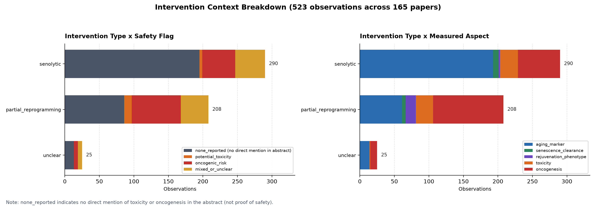
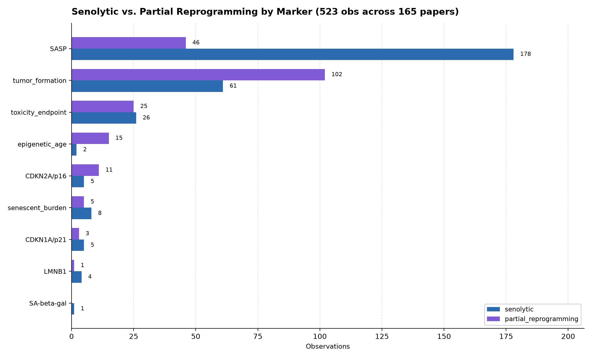

# Aging Intervention Observations DB (`AI_Aging_Project_2`)

An open-source curation pipeline and structured database cataloging **cell-type- and tissue-specific efficacy, aging marker changes, and safety signals (toxicity / oncogenesis)** for **senolytics** and **partial reprogramming** studies from PubMed and bioRxiv.

## Dataset Overview & Biological Insights (`v0.2`)

This repository aggregates structured `(intervention × cell/tissue × marker/safety endpoint)` observations extracted from PubMed and bioRxiv abstracts covering **senolytics** and **partial reprogramming**.

### 1. High-Level Distribution

* **Intervention Type:** Breakdown of extracted claims across senolytic agents, partial reprogramming strategies, and unclassified (`unclear`) mentions requiring manual review.
* **Cell Types:** Distribution of cellular contexts captured across all detected cell types (including `fibroblast`, `endothelial_cell`, `hepatocyte`, `pericyte`, `cardiomyocyte`, `microglia`, `neuron`, and `chondrocyte`).
* **Safety Flags:** Distribution of safety-related signals extracted at the abstract sentence level.

---

### 2. Intervention Context & Safety Profile

* **Safety Context (`Intervention Type × Safety Flag`):** Compares how frequently toxicity (`potential_toxicity`) or tumor/teratoma signals (`oncogenic_risk`) co-occur with each intervention class.
  > **Note:** `none_reported` indicates that no direct mention of toxicity or oncogenesis appeared in the abstract—not clinical or preclinical proof of safety.
* **Measured Biological Axes (`Intervention Type × Measured Aspect`):** Highlights differences in research focus, such as senescence clearance (`senescence_clearance`) and canonical aging markers (`aging_marker`) versus epigenetic rejuvenation (`rejuvenation_phenotype`) and safety endpoints.

---

### 3. Senolytics vs. Partial Reprogramming by Marker

* **Marker-Level Comparison:** Contrasts the frequency of specific endpoints (`CDKN2A/p16`, `CDKN1A/p21`, `SA-beta-gal`, `SASP`, `epigenetic_age`, `tumor_formation`, `toxicity_endpoint`) between senolytic and partial reprogramming literature.

---

## Repository Structure

```text
AI_Aging_Project_2/
├── data/
│   ├── raw/
│   │   ├── papers_v0_1.jsonl       # Raw metadata and abstracts from PubMed & bioRxiv
│   │   └── papers_v0_1.csv         # Tabular view of collected abstracts
│   ├── curated/
│   │   └── observations.csv        # Structured observation-level table
│   └── schema.json                 # JSON Schema defining columns, enums, and patterns
├── src/
│   ├── fetch_papers.py             # Collects abstracts from PubMed E-utilities & bioRxiv API
│   ├── extract_claims.py           # Rule-based candidate extraction into observation rows
│   └── validate.py                 # Validates observations.csv against data/schema.json
└── README.md