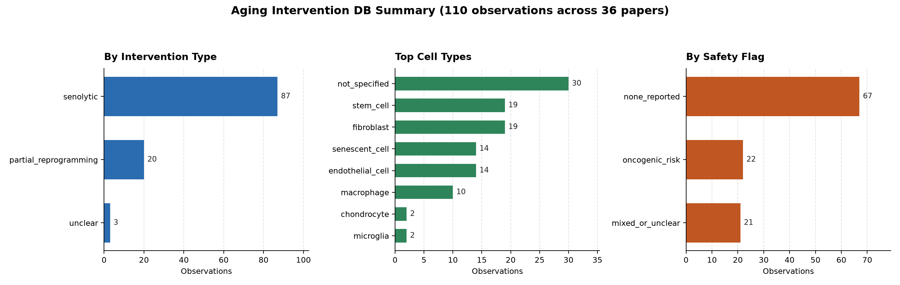

# Aging Intervention Observations DB (`AI_Aging_Project_2`)

An open-source curation pipeline and structured database cataloging **cell-type- and tissue-specific efficacy, aging marker changes, and safety signals (toxicity / oncogenesis)** for **senolytics** and **partial reprogramming** studies from PubMed and bioRxiv.



> **Status (`v0.1.0`):** Early-stage open dataset and extraction pipeline. Records marked `auto_extracted` or `needs_review` are rule-extracted candidates and are progressively verified (`human_verified`). Always verify primary sources (`record_id`, `evidence_quote`) before downstream research use.

---

## Repository Structure

```text
AI_Aging_Project_2/
├── data/
│   ├── raw/
│   │   ├── papers_v0_1.jsonl       # Raw metadata and abstracts from PubMed & bioRxiv
│   │   └── papers_v0_1.csv         # Tabular view of collected abstracts
│   ├── curated/
│   │   └── observations.csv        # Structured observation-level table
│   └── schema.json                 # JSON Schema defining columns, enums, and patterns
├── src/
│   ├── fetch_papers.py             # Collects abstracts from PubMed E-utilities & bioRxiv API
│   ├── extract_claims.py           # Rule-based candidate extraction into observation rows
│   └── validate.py                 # Validates observations.csv against data/schema.json
└── README.md